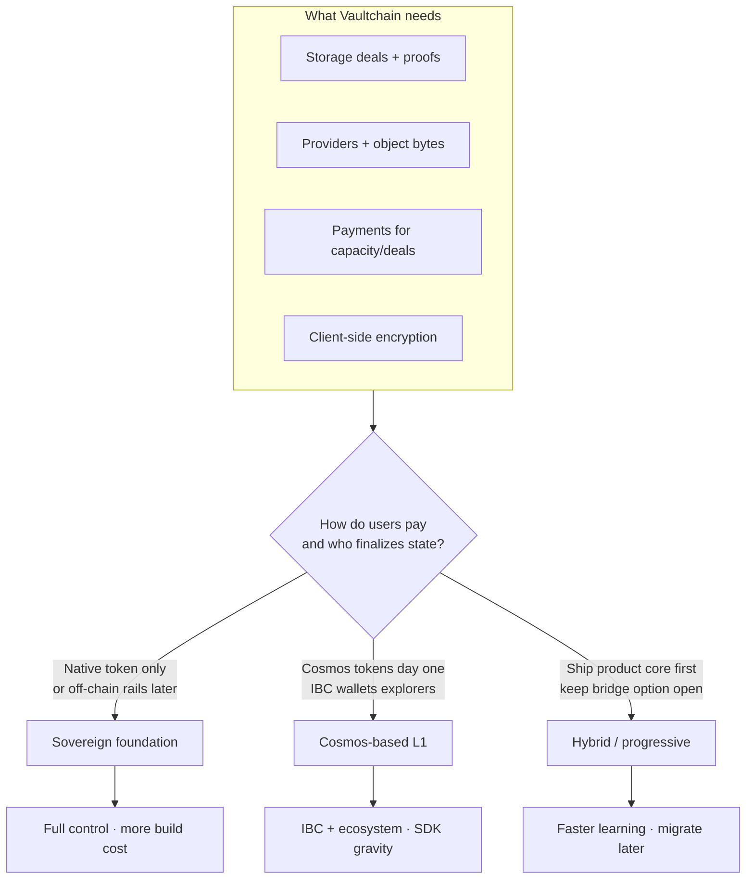
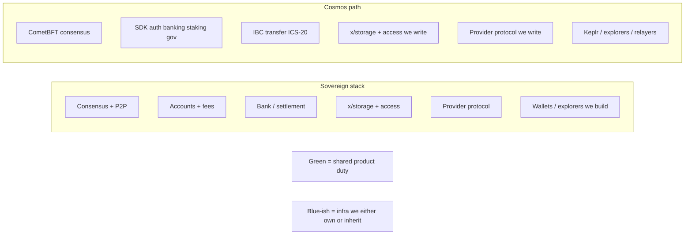
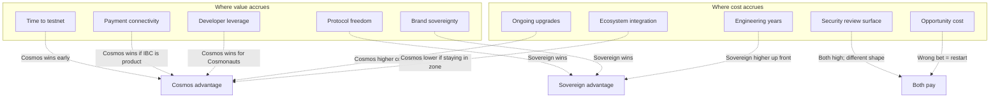
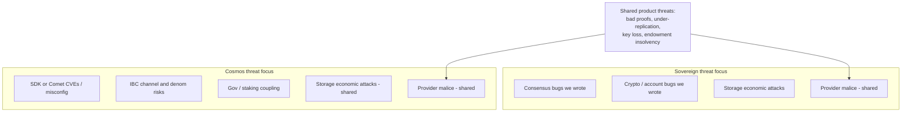
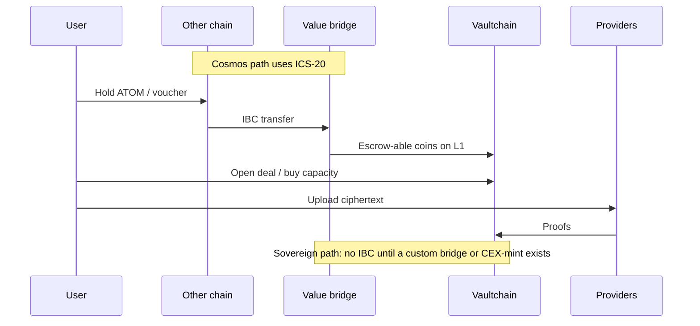
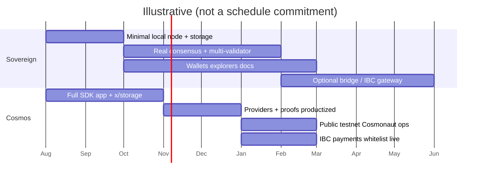
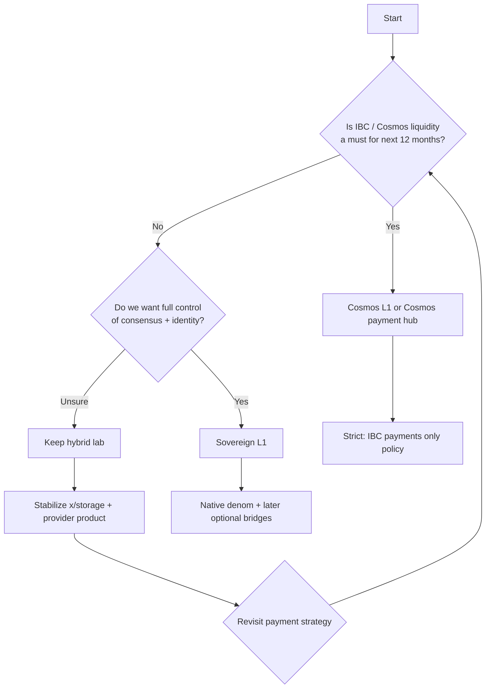

# Foundation choice: sovereign stack vs Cosmos

**Purpose:** Weigh building Vaultchain dependency-free (own foundation) against utilizing Cosmos (SDK + CometBFT + IBC).  
**Not a mandate:** This is a decision aid for product, security, cost, and speed.

**Terms**

| Term | Meaning |
|------|---------|
| **Sovereign** | Our binary, consensus, accounts, fees, and storage protocol—minimal or no Cosmos imports |
| **Cosmos path** | App-chain on Cosmos SDK + CometBFT; IBC for cross-chain tokens (payments-only for us) |
| **Hybrid** (status today) | Local vault engine + some Cosmos types; *not* a full Cosmos app or a pure sovereign L1 |

---

## 1. Decision at a glance

**One-line rule**

- Need **“pay with ATOM/OSMO/bridged USDC soon”** → favor **Cosmos** (or a Cosmos-compatible payment portal).  
- Need **“own the metal; payments are our token / card / invoice”** → favor **sovereign**.  
- Need **“prove storage product before public money rails”** → favor **hybrid**, then choose.

---

## 2. What each path actually owns

| Layer | Sovereign | Cosmos |
|-------|-----------|--------|
| BFT consensus, block gossip | Build/operate ourselves | CometBFT (maintain upgrades) |
| Addresses, keys, tx model | Our rules | SDK + bech32 conventions |
| Token bank, fees | Ours | `bank` + fee market patterns |
| Storage modules | Ours (either way) | Ours (either way) |
| Object bytes + providers | Ours (either way) | Ours (either way) |
| Cross-chain value in | Custom bridge / none | ICS-20 + whitelist |
| Client tooling | Custom or third-party | Large Cosmos ecosystem |

Storage marketplace logic is **not** the differentiator. **Settlement foundation + payment network effects** are.

---

## 3. Pros and cons matrix

### 3.1 Sovereign (dependency-free foundation)

| Pros | Cons |
|------|------|
| No SDK upgrade treadmill | Re-implement consensus, light-client story, upgrades |
| Legal/brand clarity: fully greenfield | Zero Keplr/IBC day one |
| Smaller import surface (fewer foreign CVEs in chain binary) | Must invent ops, monitoring, genesis tooling |
| Protocol freedom (proofs, fees, gas model freestyle) | Hiring/skills pool less “Cosmos-standard” |
| Can still add bridges *later* as adapters | Bridge work is hard and security-critical |
| Product story: “storage L1, not another appchain” | Users must trust a new stack + new wallets |

### 3.2 Cosmos utilization

| Pros | Cons |
|------|------|
| IBC payments path is standard | Dependency on SDK / CometBFT / IBC versions |
| Familiar ops (validators, RPC, keys) for this team already | “Just another Cosmos appchain” positioning risk |
| Ecosystem wallets, explorers, relayers | You inherit Cosmos attack surface + release cadence |
| Auditors and docs patterns exist | Module coupling, complexity for a *storage*-first product |
| Faster public testnet path if you stay in-zone | Harder to fully detach later (gravity) |
| Aligns with earlier plan: value in, infra native | Gas/denom norms may fight storage UX |

### 3.3 Hybrid / progressive (current Vaultchain lab shape)

| Pros | Cons |
|------|------|
| Prove deals/proofs/provider/lab without full stack bet | Not production BFT yet |
| Can peel off Cosmos types over time | Ambiguous for marketing (“is it Cosmos?”) |
| Cheap experiment on settlement design | Risk of accidental lock-in or dual maintenance |

---

## 4. Benefits vs cost (economic frame)

Rough order-of-magnitude framing (qualitative, not a quote):

| Cost type | Sovereign | Cosmos |
|-----------|-----------|--------|
| **Year 0 engineering** | High (consensus + node + tooling) | Medium (custom modules + configure app) |
| **Year 1–3 maintenance** | Medium (your code, your bugs) | Medium–high (track SDK major upgrades) |
| **Security budget** | Fund *full* L1 audit | Fund *modules +* residual SDK risk |
| **Distribution / GTM** | You build interest in a new chain | Ride Cosmos channels + still need storage narrative |
| **Payment rails** | DIY or delayed | ICS-20 + relayers sooner |
| **Switching cost later** | Low early if modules stay portable | High once wallets, IBC channels, validators locked in |

---

## 5. Security and dependency surface

**Dependency-free does not mean “no risk.”** It means **you concentrate risk in code you control** instead of **spreading risk across upstream + your modules**.  
**Cosmos does not mean “secure by default.”** It means **many eyes / known patterns**, plus **forced upgrade discipline**.

Neither path removes the hard storage threats (provider malice, permanent-class economics, encryption key loss).

---

## 6. IBC / payments: the real coupling point

Our product rule already: **money may come from outside; storage infrastructure stays native.**

| Need | Sovereign | Cosmos |
|------|-----------|--------|
| ICS-20 in year 1 | Not native | Natural fit |
| Native `uvault` only | Natural fit | Still possible |
| Card / Stripe / invoice | Off-chain + credit on L1 (both) | Same pattern |
| Ethereum USDC | Custom bridge or third party (both hard) | Same; IBC ≠ Ethereum |

**Conclusion:** If **cross-Cosmos payments** are a near-term GTM pillar, Cosmos (or a thin Cosmos-facing payment hub) earns its keep. If they are **optional later**, sovereign is not blocked—only delayed on that rail.

---

## 7. Time-to-milestone sketch

Sovereign tends to **back-load** “real chain” work; Cosmos tends to **front-load** framework glue then **tax you forever** on upgrades.

---

## 8. Scorecard (fill with weights)

Score 1–5 (5 = strong yes). Multiply by your weight.

| Criterion | Weight (example) | Sovereign | Cosmos | Notes |
|-----------|------------------|-----------|--------|-------|
| IBC / Cosmonaut payments needed ASAP | 5 | 1 | 5 | Highest differentiator |
| Brand “not an appchain clone” | 4 | 5 | 2 | Marketing + politics |
| Team speed with current skills | 4 | 2 | 4 | You already ran Jackal/Cosmos ops |
| Minimize multi-year upstream tax | 3 | 4 | 2 | SDK major revisions hurt |
| Year-0 audit & launch risk | 5 | 2 | 3 | Green L1 harder to prove |
| Protocol flexibility for proofs/economy | 4 | 5 | 3 | Both fine; sovereign freer |
| Talent hire / external tooling | 3 | 2 | 4 | Cosmos wider tooling |
| Legal clean-room clarity | 3 | 5 | 4 | Both OK if no Jackal copy |
| **Weighted total (example)** | | **calc** | **calc** | Sum weight×score |

**Example interpretation (using weights above):** Cosmos often wins if IBC weight is high; sovereign wins if brand + freedom + long-term independence dominate.

---

## 9. Recommendation patterns

### When to pick **Cosmos**
- Fundraising / users assume wallet = Keplr-class  
- Deals denominated in foreign Cosmos assets early  
- You want multi-validator mainnet ops that “look like known chains”

### When to pick **sovereign**
- Storage product is the only network effect that matters  
- Payments are native, credit, or non-Cosmos rails  
- You accept longer path to hardened consensus  
- Brand is intentionally **not** “another Cosmos SDK app”

### When to stay **hybrid** (practical middle)
- Next 1–2 milestones: provider quality, proof model, encryption UX, tokenomics *design*  
- Module APIs stay portable so settlement backend can swap  
- Explicit kill criteria: e.g. “if IBC required by date X → Cosmify; else peel SDK types”

---

## 10. Cost of being “wrong”

| If you chose… | And reality is… | Cost |
|---------------|-----------------|------|
| Cosmos | IBC unused for years | Continuously pay upgrade tax for unused value |
| Cosmos | You need radical protocol change | Fight framework or fork painfully |
| Sovereign | Users demand ATOM/USDC payments immediately | Build bridge under time pressure (high risk) |
| Sovereign | Underestimate consensus work | Delayed mainnet; trust gap |
| Hybrid forever | No decision | Dual mental model; confused contributors |

Portability of **`x/storage` deals/proofs/provider wire format** is the main hedge. Settlement (Cosmos vs own) should stay a **pluggable underside** as long as possible.

---

## 11. Summary table

| Dimension | Dependency-free (sovereign) | Utilize Cosmos |
|-----------|----------------------------|----------------|
| **Control** | Maximum | Shared with ecosystem norms |
| **Dependencies** | Minimal intentional libs | SDK, CometBFT, often IBC-go |
| **Payments abroad** | Build later | IBC path is first-class |
| **Speed to rough L1** | Medium (you already have lab engine) | Medium–fast with Ignite/simapp once toolchain works |
| **Speed to cosmonaut UX** | Slow | Faster |
| **Long-run autonomy** | High | Medium (upgrade gravity) |
| **Best if** | Product = storage, money is secondary shape | Product needs Cosmos capital/users early |

**Bottom line:** Free-from-Cosmos is viable and aligned with a clean-room storage L1 story; Cosmos is mainly paying for **payment interop and ecosystem gravity**, not for the storage invention itself. Choose based on **whether IBC-class payments are a 12-month necessity**, not on “real chains must use Cosmos.”

---

## Related docs

- [Phase 0 spec](./PHASE0-SPEC.md)  
- [IBC payments-only policy](./IBC-PAYMENTS-ONLY.md)  
- Repo README for current lab stack shape
